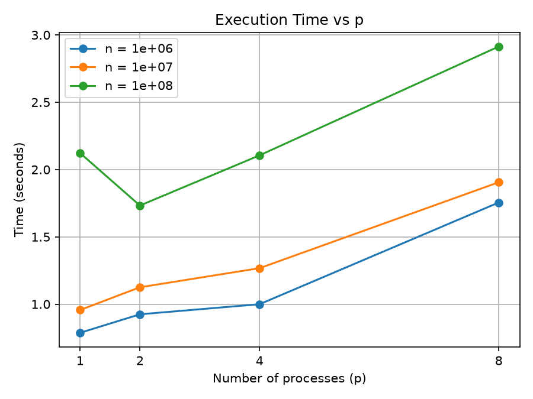
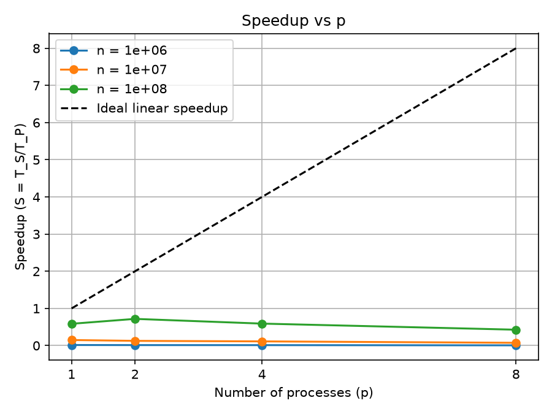
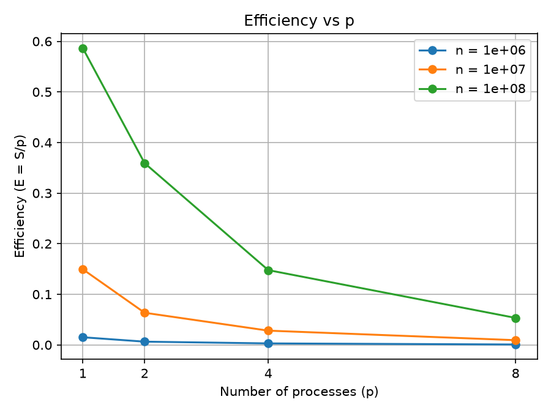
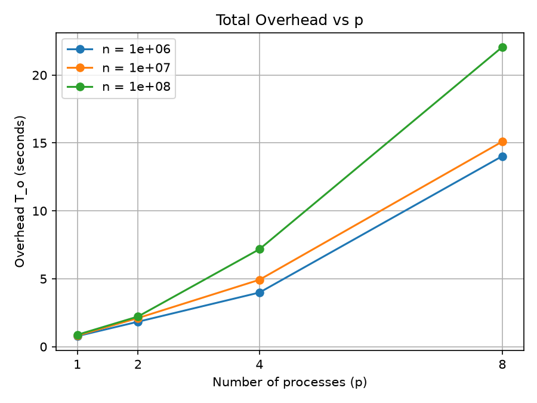
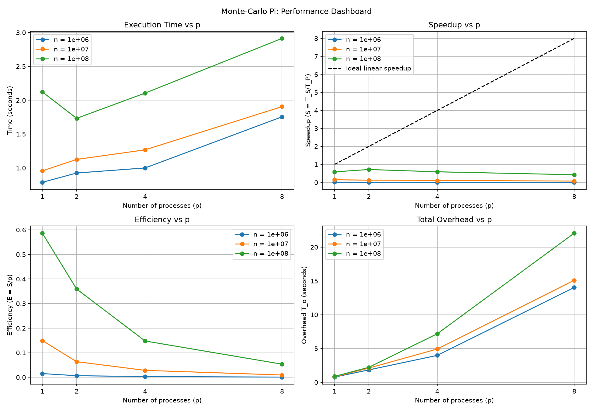

# PDC-A4: Parallel Performance Analyzer
Monte-Carlo estimation of π using Python multiprocessing. **Workload: Option 3.**

## Machine Specs
CPU: 11th Gen Intel Core i7-1185G7 @ 3.00GHz | Cores/Threads: 4/8 | RAM: 16 GB | OS: Windows 10 Pro (Version 2009, Build 26200)

## How to Run
pip install -r requirements.txt
python src/main.py

## Results
PS D:\PDC Assignment 4\PDC-A4-23F-0734> python src/main.py
n=1000000 done
n=10000000 done
n=100000000 done
        n  p    T_S    T_P  speedup  efficiency    cost  overhead  serial_fraction
  1000000  1 0.0119 0.7874   0.0151      0.0151  0.7874    0.7755              NaN
  1000000  2 0.0119 0.9249   0.0129      0.0064  1.8498    1.8378         154.0923
  1000000  4 0.0119 0.9998   0.0119      0.0030  3.9991    3.9872         111.4334
  1000000  8 0.0119 1.7552   0.0068      0.0008 14.0416   14.0297         168.0436
 10000000  1 0.1431 0.9569   0.1495      0.1495  0.9569    0.8139              NaN
 10000000  2 0.1431 1.1257   0.1271      0.0636  2.2513    2.1082          14.7350
 10000000  4 0.1431 1.2675   0.1129      0.0282  5.0698    4.9268          11.4781
 10000000  8 0.1431 1.9056   0.0751      0.0094 15.2451   15.1021          15.0789
100000000  1 1.2448 2.1225   0.5865      0.5865  2.1225    0.8777              NaN
100000000  2 1.2448 1.7328   0.7184      0.3592  3.4656    2.2208           1.7840
100000000  4 1.2448 2.1056   0.5912      0.1478  8.4222    7.1774           1.9219
100000000  8 1.2448 2.9138   0.4272      0.0534 23.3105   22.0656           2.5322

Estimated n needed for E >= 0.6:
  p=2: n >= 2.68e+08
  p=4: n >= 8.65e+08
  p=8: n >= 2.66e+09
PS D:\PDC Assignment 4\PDC-A4-23F-0734> 

## Figures

## Analysis
The results show that the Monte-Carlo workload is embarrassingly parallel: each worker generates its own random samples independently and only one integer count is returned, so communication is minimal. For the small problem size (n = 10⁶), speedup is far from ideal because the fixed cost of creating the process pool, pickling arguments and collecting results (parallel overhead) is comparable to the useful computation time. This produces low efficiency and a high total overhead T_o = p·T_P − T_S. As n grows to 10⁷ and 10⁸, the computation time dominates the startup overhead, so speedup moves closer to the ideal linear line and efficiency rises. This confirms that the program is scalable in the sense of the isoefficiency concept: efficiency can be kept constant by increasing the problem size as p increases.

Efficiency generally decreases as p increases for a fixed n, since overhead grows with p (more processes to spawn and synchronize) while the work per process shrinks. At p = 8 the speedup flattens when p exceeds the number of physical cores of my machine, because hyper-threads share execution units and memory bandwidth; this is a hardware scalability limit. Other overhead sources include process start-up, inter-process communication, memory contention and load imbalance (small, since samples are divided equally).

The speedup curve also tells us about the parallel fraction. Using Amdahl's law, the measured serial fraction f is small (close to zero for large n), meaning most of the program (>95%) is parallelizable. The serial part is only pool creation and the final summation. Because f decreases as n increases, the maximum speedup 1/f increases, so larger problems scale better. In conclusion, the program shows good strong scaling for large n, but small problems are overhead-bound and gain little from additional processes.